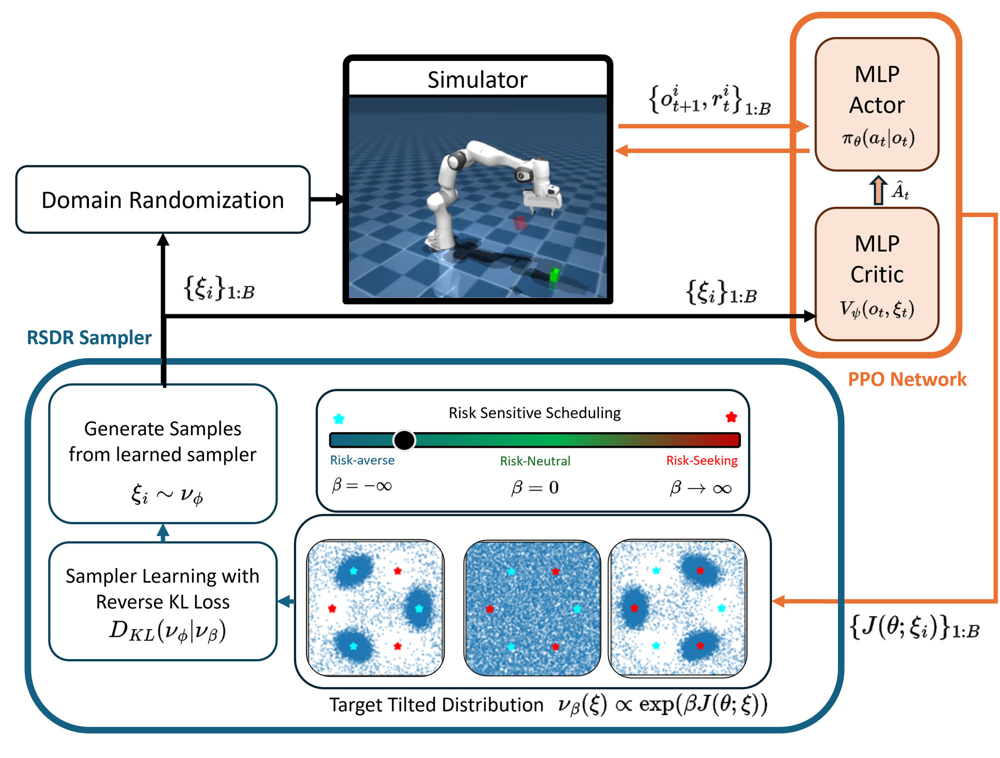

# Risk-Sensitive Domain Randomization (RSDR)

<p align="center">
  
  
  
</p>

Implementation accompanying **Distributionally Robust Domain Randomization with Learned Risk-Sensitive Dynamics Samplers**.

<p align="center">
  
</p>
<p align="center"><em>
  RSDR overview. The sampler &nu;<sub>&phi;</sub> proposes dynamics &xi;<sub>1:B</sub> for the simulator and the asymmetric critic;
  PPO returns J(&theta;;&xi;) define the tilted target &nu;<sub>&beta;</sub>, which the sampler fits by reverse KL.
</em></p>

### How it works

1. **Sample dynamics.** Draw a batch $\{\xi_i\}_{1:B} \sim \nu_\phi$ from the learned sampler and apply them through domain randomization.
2. **Update the policy.** Train PPO on the resulting rollouts. The critic $V_\psi(o_t, \xi_t)$ sees the dynamics; the actor $\pi_\theta(a_t \mid o_t)$ does not.
3. **Update the sampler.** Use the returns $\{J(\theta;\xi_i)\}_{1:B}$ to form the tilted target $\nu_\beta$ and minimize $D_{\mathrm{KL}}(\nu_\phi \,\|\, \nu_\beta)$.

| $\beta$ | Behavior | Sampler focuses on |
| --- | --- | --- |
| $\beta < 0$ | Risk-averse | Low-return (hard) dynamics |
| $\beta = 0$ | Risk-neutral | Uniform over the domain |
| $\beta > 0$ | Risk-seeking | High-return (easy) dynamics |

RSDR alternates PPO policy updates with learning a distribution over latent dynamics parameters. The sampler approximates the exponentially tilted target

$$
\nu_\beta(\xi;\theta) \propto \exp\!\bigl(\beta J(\theta;\xi)\bigr)\,\nu_0(\xi),
$$

where $\nu_0$ is uniform over the specified domain. Negative $\beta$ emphasizes low-return dynamics, zero recovers the uniform target, and positive $\beta$ emphasizes high-return dynamics. The default sampler uses reverse-KL Gaussian mixture variational inference (GMMVI). A diffusion-based DIS-LV variant and PPO domain-randomization baselines are also included.

Training uses JAX, Flax, Brax, and MuJoCo Playground, with an asymmetric critic that can observe dynamics parameters during training. The policy receives the ordinary state observation.

## Installation

Use Python 3.12 (validated in the `jax_flow` environment) and a Linux machine with an NVIDIA GPU for the benchmark runs. The manuscript reports an RTX 3090 (24 GB), 64 GB RAM, and an Intel Core i9-10980XE. Start from an editable checkout so environment assets and downloaded robot models remain in a predictable location.

```bash
git clone https://github.com/jeongsukchul/risk-sensitive-domain-randomization.git
cd risk-sensitive-domain-randomization
conda create -n jax_flow python=3.12
conda activate jax_flow
python -m pip install --upgrade pip
python -m pip install --upgrade "jax[cuda12]"
python -m pip install -e .
python -c "import jax; print(jax.devices())"
```

Choose the JAX CUDA build appropriate for your driver using the [official installation guide](https://docs.jax.dev/en/latest/installation.html). `requirements.txt` is the package dependency source; it is **not** a complete lockfile of the original paper environment. See [reproducibility details](docs/reproducibility.md) for the validation environment and known manuscript/code differences.

Environment registration may download the MuJoCo Menagerie assets on first import, including configuration inspection, into `external_deps/mujoco_menagerie`, at the revision specified in `custom_envs/mjx_env.py`. Allow internet access and disk space for that initial download. Headless rendering defaults to EGL; set `MUJOCO_GL` yourself if your system needs another backend.

## Quick start

Run commands from the repository root. `learning/run.py` is the training entry point; there is no `train.py` entry point in the repository root.

```bash
# Risk-averse RSDR, without a Weights & Biases account.
python -m learning.run task=AcrobotSwingup policy=gmmppo beta=-10 \
  seed=0 use_wandb=false save_video=false eval_grid_size_2d=64

# Uniform domain randomization (UDR), with the same evaluation grid.
python -m learning.run task=AcrobotSwingup policy=ppo \
  seed=0 use_wandb=false save_video=false eval_grid_size_2d=64
```

These use the full task training budget. To check installation with a small run:

```bash
python -m learning.run task=AcrobotSwingup policy=gmmppo beta=-10 \
  use_wandb=false save_video=false impl=jax \
  num_envs=32 batch_size=32 num_timesteps=256 num_evals=1 \
  +unroll_length=8 +num_minibatches=1 +num_updates_per_batch=1 \
  eval_grid_size_2d=4 empirical_num_rollouts=2 work_dir=/tmp/rsdr-smoke
```

The first run includes JIT compilation. A smoke run checks execution and output generation; it does not measure benchmark performance.

To enable W&B, run `wandb login`, then use `use_wandb=true wandb_project=rsdr` and optionally `wandb_entity=YOUR_ENTITY`. Videos are generated when both `save_video=true` and `use_wandb=true`.

## Methods

| Method | Hydra option | Main sampler options |
| --- | --- | --- |
| RSDR, GMMVI | `policy=gmmppo` | `beta`, `sampler_update_freq` |
| RSDR, DIS-LV | `policy=gbsppo` | `beta`, `n_sampler_iters` |
| Uniform DR | `policy=ppo` | Uniform samples over the task's domain |
| Nominal PPO | `policy=ppo_nodr` | Fixed nominal dynamics |
| EPOpt | `policy=epoptppo` | `epsilon` (retained lower-return fraction) |
| AutoDR | `policy=adrppo` | `success_threshold` |
| DORAEMON | `policy=doraemonppo` | `success_threshold`, `success_rate_condition`, `trust_region_threshold` |
| GOFLOW | `policy=flowppo` | `beta`, `gamma`, `n_sampler_iters` |

For `gmmppo`, `beta=0` learns the maximum-entropy uniform **target** within the variational family. Use `policy=ppo` for direct uniform sampling. The main RSDR experiments fix `beta`; an adaptive fixed-KL-radius extension is described in [the detailed guide](docs/reproducibility.md#fixed-kl-radius-extension).

Examples, with local logging:

```bash
python -m learning.run task=CheetahRun policy=gbsppo beta=-10 use_wandb=false save_video=false
python -m learning.run task=CheetahRun policy=flowppo beta=1 gamma=0.5 use_wandb=false save_video=false
python -m learning.run task=CheetahRun policy=epoptppo epsilon=0.4 use_wandb=false save_video=false
python -m learning.run task=CheetahRun policy=adrppo success_threshold=0.7 use_wandb=false save_video=false
python -m learning.run task=CheetahRun policy=doraemonppo success_threshold=0.7 \
  success_rate_condition=0.7 trust_region_threshold=0.005 use_wandb=false save_video=false
```

GOFLOW uses `beta` as its return-tilting coefficient in this implementation; `alpha` is not a supported configuration key. Baseline hyperparameters require task-specific tuning; these examples are starting configurations.

## Benchmarks and reproduction

| Task | Dynamics dimensions | Environment source |
| --- | ---: | --- |
| `AcrobotSwingup` | 2 | `custom_envs/dm_control_suite/acrobot.py` |
| `CartpoleSwingup` | 2 | `custom_envs/dm_control_suite/cartpole.py` |
| `CheetahRun` | 2 | `custom_envs/dm_control_suite/cheetah.py` |
| `WalkerWalk` | 15 | `custom_envs/dm_control_suite/walker.py` |
| `PandaPickCubeOrientation` | 29 | `custom_envs/manipulation/franka_emika_panda/pick.py` |
| `PandaOpenCabinet` | 30 | `custom_envs/manipulation/franka_emika_panda/open_cabinet.py` |

The manuscript uses 10 training seeds, a 64×64 grid for 2D tasks, and 16,384 uniform parameter settings for higher-dimensional tasks. Returns at each setting are averaged over 10 evaluation seeds. The current 2D default is 128×128; pass `eval_grid_size_2d=64` to select the manuscript resolution. Higher-dimensional evaluation collects four batches of 4,096 settings after each training epoch.

Use the sweep scripts to generate repeatable commands. They support `TASKS`, `SEEDS`, `BETAS`/`POLICIES`, `PYTHON`, `WANDB_PROJECT`, and extra Hydra overrides. Inspect the commands first:

```bash
# Preview two RSDR runs without starting training.
DRY_RUN=1 TASKS="AcrobotSwingup" SEEDS="0 1" BETAS="-10" \
  bash learning/commands/reproduce.sh use_wandb=false save_video=false

# Train the selected runs.
TASKS="AcrobotSwingup" SEEDS="0 1" BETAS="-10" \
  bash learning/commands/reproduce.sh use_wandb=false save_video=false

# Preview UDR and EPOpt baselines.
DRY_RUN=1 TASKS="CheetahRun" SEEDS="0" POLICIES="ppo epoptppo" \
  bash learning/commands/baselines.sh epsilon=0.4 use_wandb=false save_video=false
```

With no environment overrides, the RSDR script runs all six tasks, ten seeds, and eleven beta values. This is a large sequential sweep. Review [the domain-range discrepancy and evaluation details](docs/reproducibility.md#manuscript-alignment) before claiming exact reproduction of the paper's tables. Older scripts under `learning/commands/` retain exploratory settings and seed ranges.

## Configuration and outputs

Hydra loads [`learning/config.yaml`](learning/config.yaml); task-specific PPO defaults live in [`learning/configs/`](learning/configs/). `num_envs`, `batch_size`, `num_timesteps`, and `num_evals` use task defaults when set to `null`. Use `key=value` for existing configuration keys and `+key=value` to add PPO options such as `+learning_rate=0.001`.

```bash
# Inspect the Hydra configuration without training.
python -m learning.run --cfg job
```

Runs are saved under `logs/<task>/<seed>/<policy>/`, with sampler settings appended for adaptive methods; for example, `logs/AcrobotSwingup/0/gmmppo/beta=-10/`. `work_dir=/absolute/path` overrides the base directory. Repeating the same task/seed/options reuses that location, so choose a new `work_dir` for separate runs.

| Output | Contents |
| --- | --- |
| `cfg/config.yaml` | Default Hydra configuration |
| `cfg/resolved_config.yaml` | Run configuration including CLI overrides |
| `cfg/ppo_config.yaml`, `cfg/env_config.yaml` | Effective task PPO and environment settings |
| `models/<step>/` | Orbax policy checkpoints |
| `models/<policy>_params_latest.pkl` | Latest inference parameters |
| `models/<policy>_percentile_dynamics_params_latest.json` | Dynamics settings selected at return percentiles |
| `results/<sampler>/` | Evaluation returns, sampler samples, and available diagnostics/checkpoints |
| `computational_cost.csv` | Training transitions, policy/sampler updates, and timing |

For evaluation under time-varying dynamics, use the restored-policy evaluator:

```bash
python -m learning.eval_nonstationary --task AcrobotSwingup --policy ppo \
  --seeds 0 --dist_type random_walk --rw_scale 0.01
```

See the [detailed guide](docs/reproducibility.md) for Langevin attacks, sampler diagnostics, fixed-radius updates, and cost measurements.

## Code map

```text
learning/
  run.py                      Hydra training entry point
  config.yaml                 Shared configuration
  configs/                    Task PPO defaults
  agents/sampler_ppo/         PPO, sampler objectives, evaluation, and checkpoint helpers
  module/gmmvi/               Gaussian mixture variational inference
  module/gbs/                 Diffusion sampler and toy experiments
  module/bijx/                Flow sampler implementation
  module/wrapper/             Randomized training and evaluation wrappers
  commands/                   Sweep and experiment scripts
custom_envs/
  dm_control_suite/           DM Control tasks and randomization ranges
  manipulation/              Manipulation tasks and randomizers
  locomotion/                Additional locomotion environments
```

See the [agent internals guide](learning/agents/sampler_ppo/README.md) for module responsibilities and checkpoint compatibility.

The `jax_flow` validation completed 41 regression checks, all eight training-method smoke runs, fixed-radius and Warp runs, and JIT reset/step checks for the six manuscript tasks. The release checkout omits the test source files after validation. See [validation details](docs/reproducibility.md#validation) for the environment, scope, and fixes. Use the [quick-start smoke command](#quick-start) to check a new installation.

## Acknowledgements

This implementation builds on [MuJoCo Playground](https://github.com/google-deepmind/mujoco_playground), [Brax](https://github.com/google/brax), [variational_sampling_methods](https://github.com/DenisBless/variational_sampling_methods) for GMMVI, [sde_sampler](https://github.com/juliusberner/sde_sampler) for DIS-LV, and [bijx](https://github.com/mathisgerdes/bijx) for normalizing flows. Existing source license headers and attributions are retained. The repository does not currently declare a project-wide license.
